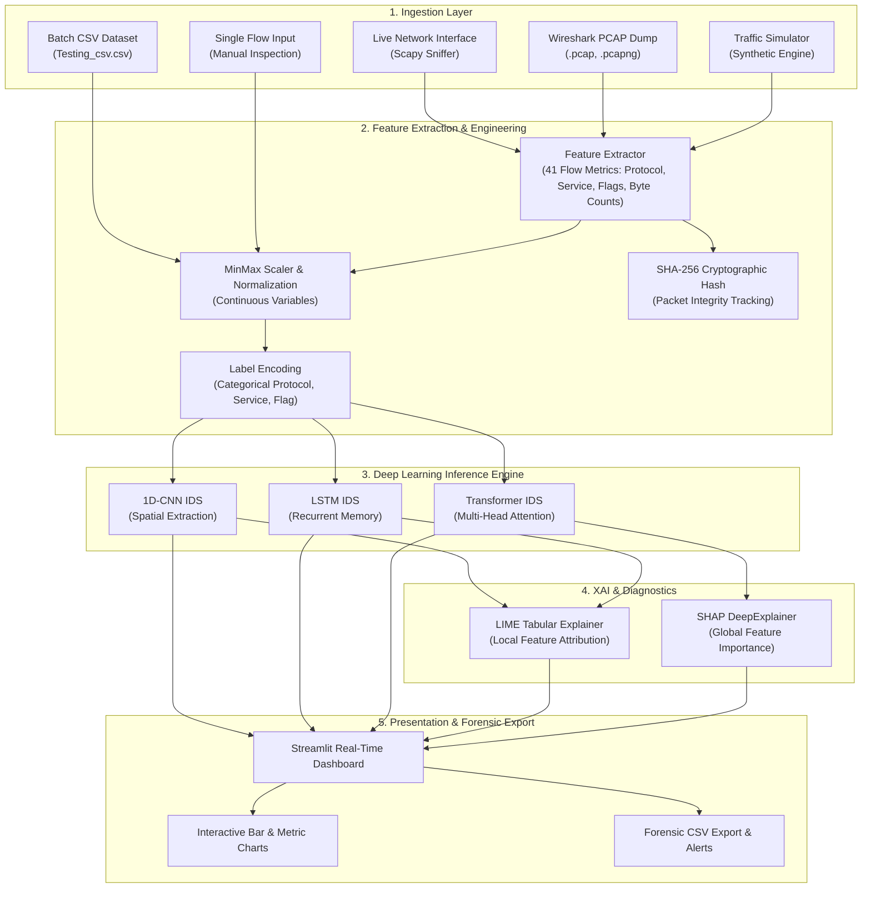

<div align="center">

# 🛡️ IntrusionX: Next-Gen AI-Powered Intrusion Detection System (IDS)
### Real-Time Network Packet Inspection, Deep Learning Classification & Explainable AI (XAI)

[](https://www.python.org/)
[](https://pytorch.org/)
[](https://streamlit.io/)
[](https://scapy.net/)
[](https://www.wireshark.org/)
[](https://github.com/slundberg/shap)
[](https://www.unb.ca/cic/datasets/nsl.html)

<p align="center">
  <b>A state-of-the-art Deep Learning Network Intrusion Detection System (NIDS) designed to classify network traffic into 22 distinct attack categories and normal flows with real-time live sniffing, PCAP forensic analysis, traffic simulation, and Explainable AI diagnostics.</b>
</p>

---

[Key Features](#-key-features) •
[System Architecture](#-system-architecture) •
[Supported Attack Classes](#-supported-attack-categories) •
[Model Architectures & Benchmarks](#-model-architectures--benchmarks) •
[Project Structure](#-project-structure) •
[Quick Start & Installation](#-quick-start--installation) •
[Interactive Dashboard Walkthrough](#-interactive-dashboard-walkthrough) •
[CLI & Training Pipeline](#-cli--training-pipeline) •
[Troubleshooting](#-troubleshooting--faqs) •
[Dataset Information & Links](#-dataset-information--download-links)

---

</div>

## 📌 Executive Summary

Modern cyber threats operate at blistering speeds, making traditional signature-based Intrusion Detection Systems (like standard Snort or Suricata rules) insufficient against zero-day exploits, mutated payloads, and polymorphic attack vectors.

**IntrusionX** bridges the gap between low-level network packet analysis and state-of-the-art deep learning. By combining:
1. **Scapy & Wireshark** integration for live packet capture, Layer-2/Layer-3 socket filtering, and PCAP replay,
2. **PyTorch Deep Neural Architectures** (1D Convolutional Neural Networks, Long Short-Term Memory networks, and Multi-Head Self-Attention Transformer Encoders),
3. **Explainable AI (XAI)** powered by LIME and SHAP to interpret why a packet was classified as anomalous, and
4. **Interactive Streamlit Web Dashboard** offering instantaneous alerts, distribution charts, traffic simulation, and CSV forensic export.

IntrusionX provides security analysts and network administrators with a unified, transparent, and battle-tested threat detection platform.

---

## 🚀 Key Features

- **🧠 Multi-Model Deep Learning Core**:
  - **1D-CNN (Convolutional Neural Network)**: Extracts spatial correlation and packet header feature interactions.
  - **LSTM (Long Short-Term Memory)**: Captures recurrent and sequential patterns across network flows.
  - **Transformer Encoder**: Employs multi-head self-attention mechanisms to identify long-range dependencies across complex network behaviors.
- **📡 Wireshark & PCAP File Forensic Ingestion**:
  - Full support for `.pcap`, `.pcapng`, and `.cap` capture dumps.
  - Automatic conversion from raw packet bytes into 41 standard NSL-KDD network flow metrics.
- **🔴 Real-Time Live Network Sniffing**:
  - Live capture on any network interface (`Ethernet`, `Wi-Fi`, or `any`).
  - Seamless Windows fallback mechanism (Layer 2 Npcap / WinPcap to Layer 3 raw sockets).
- **🎲 Network Traffic Simulation Engine**:
  - Built-in traffic synthesizer allowing testing in restricted or sandbox environments without root/administrator privileges.
  - Generates realistic benign flows alongside synthetic port scans, SYN floods, and buffer overflow attempts.
- **🔍 Single Flow Interactive Diagnostic Laboratory**:
  - Input custom network metrics (flags, protocol, service, duration, src/dst bytes, failed logins, error rates) to receive real-time classification.
- **💡 Explainable AI (XAI) Diagnostics**:
  - **LIME** (Local Interpretable Model-agnostic Explanations) generate readable feature contribution scorecards and HTML reports.
  - **SHAP** (SHapley Additive exPlanations) DeepExplainer computes global and local Shapley values to visualize feature impact.
- **🔒 Forensic Cryptographic Integrity**:
  - Integrated SHA-256 cryptographic packet hashing (`cryptography` library) ensuring immutable forensic audit trails for all analyzed streams.

---

## 🏛️ System Architecture



---

## 🎯 Supported Attack Categories

IntrusionX is trained on the comprehensive **NSL-KDD** benchmark and categorizes network traffic into **Normal Traffic** plus **21 distinct intrusion types** spanning all 4 foundational MITRE/DoD network attack categories:

| Attack Category | Description | Detected Intrusion Types in IntrusionX |
| :--- | :--- | :--- |
| **Normal** | Legitimate, non-malicious user connection | `normal` |
| **DoS (Denial of Service)** | Flooding targets with excessive traffic or packets to exhaust resources and deny access to legitimate users | `neptune`, `smurf`, `teardrop`, `pod`, `land`, `back` |
| **Probe (Surveillance & Reconnaissance)** | Scanning network topology, ports, and services to identify vulnerabilities prior to launching exploits | `ipsweep`, `portsweep`, `nmap`, `satan` |
| **R2L (Remote to Local)** | Unauthorized access from a remote machine into a local machine by exploiting network vulnerabilities | `guess_passwd`, `ftp_write`, `imap`, `phf`, `spy`, `warezclient`, `warezmaster` |
| **U2R (User to Root)** | Gaining superuser/root administrative privileges starting from a standard local user account | `buffer_overflow`, `loadmodule`, `rootkit` |

---

## 📊 Model Architectures & Benchmarks

The system incorporates three distinct deep learning architectures implemented in PyTorch (`models.py`). All models were trained and benchmarked on **25,195 validation samples** from the NSL-KDD dataset:

### 1. Comparative Performance Matrix

| Model Architecture | Test Accuracy | Precision (Weighted) | Recall (Weighted) | F1-Score (Weighted) | Best Suited For |
| :--- | :---: | :---: | :---: | :---: | :--- |
| **Transformer IDS** 🏆 | **78.88%** | **78.44%** | **78.88%** | **77.19%** | Complex multi-vector threats & long-range feature interactions |
| **1D-CNN IDS** | **74.04%** | **73.18%** | **74.04%** | **71.92%** | High-throughput ultra-low-latency edge packet inspection |
| **LSTM IDS** | **71.03%** | **70.70%** | **71.03%** | **67.40%** | State-driven connection sequences and session flow tracking |

### 2. Architecture Specifications

#### 🔹 Transformer IDS (`TransformerIDS`)
- **Input Dimension**: Variable normalized flow features ($D_{in} = 41$).
- **Linear Embedding**: Maps input vector to $d_{\text{model}} = 64$.
- **Attention Layer**: 2-layer `TransformerEncoder` with 4-head multi-head self-attention (`nhead=4`).
- **Pooling & Classification**: Mean pooling over the sequence dimension followed by a linear classification head producing logits over all 22 target classes.

#### 🔹 1D Convolutional IDS (`CNNIDS`)
- **Conv1D Layer**: 1 input channel, 32 filters, kernel size = 3.
- **Activation & Pooling**: ReLU activation followed by MaxPool1D (kernel size = 2).
- **Dense Layers**: Fully connected layer of 128 hidden units with ReLU dropout regularization, terminating in the 22-class output projection.

#### 🔹 Long Short-Term Memory IDS (`LSTMIDS`)
- **LSTM Recurrent Cell**: Input dimension $D_{in}$, hidden state dimension = 64, `batch_first=True`.
- **Temporal Extraction**: Uses final hidden state $h_n[-1]$ representing sequential context.
- **Classification Head**: Fully connected linear projection to 22 output classes.

---

## 📁 Project Structure

```text
IntrusionX/
│
├── data/                                         # Datasets & evaluation samples
│   ├── KDDTrain_plus.txt                         # Raw NSL-KDD Training Dataset (~125,973 records)
│   ├── nsl_kdd_cleaned.csv                       # Cleaned, preprocessed training dataset
│   └── Testing_csv.csv                           # Sample batch dataset for quick UI/pipeline tests
│
├── saved_models/                                 # Serialized PyTorch weights & label encoders
│   ├── saved_model_CNN.pt                        # Pre-trained CNN model checkpoint
│   ├── saved_model_LSTM.pt                       # Pre-trained LSTM model checkpoint
│   ├── saved_model_Transformer.pt                # Pre-trained Transformer model checkpoint
│   ├── label_encoder_CNN.pkl                     # Serialized scikit-learn LabelEncoder for CNN
│   ├── label_encoder_LSTM.pkl                    # Serialized scikit-learn LabelEncoder for LSTM
│   └── label_encoder_Transformer.pkl             # Serialized scikit-learn LabelEncoder for Transformer
│
├── reports/                                      # Benchmark reports and evaluation logs
│   └── evaluation_results.txt                    # Classification reports, precision/recall & confusion matrices
│
├── ui_with_wireshark.py                          # Full-featured Streamlit UI (4 tabs, live sniffing, PCAP)
├── main.py                                       # Training, evaluation & XAI pipeline CLI
├── models.py                                     # PyTorch architectures (CNNIDS, LSTMIDS, TransformerIDS)
├── utils.py                                      # Preprocessing, MinMaxScaler, SHA-256 packet hashing
├── preprocessing.py                              # Raw NSL-KDD txt parser & column assigner
├── explain.py                                    # Explainable AI module (LIME Tabular & SHAP DeepExplainer)
├── test_pipeline.py                              # Automated sanity verification script
│
├── requirements.txt                              # Python package dependencies
├── run_web.bat                                   # One-click Windows CMD launcher for Streamlit App
├── run_web.ps1                                   # One-click Windows PowerShell launcher
├── .gitignore                                    # Production Git ignore rules
├── .gitattributes                                # GitHub Linguist stats configuration
└── README.md                                     # Full technical documentation
```

---

## ⚙️ Quick Start & Installation

### Option A: One-Click Launch (Windows)
If you already have Python and the virtual environment set up in the directory:
1. Double-click `run_web.bat`, or
2. Open PowerShell and run:
   ```powershell
   .\run_web.ps1
   ```
Your default web browser will automatically open `http://localhost:8501`.

---

### Option B: Manual Setup (Windows / Linux / macOS)

#### 1. Clone the Repository & Navigate to Project Root
```bash
git clone https://github.com/hasim2006/IntrusionX.git
cd IntrusionX
```

#### 2. Create and Activate a Virtual Environment
- **Windows (PowerShell)**:
  ```powershell
  python -m venv .venv
  .\.venv\Scripts\Activate.ps1
  ```
- **Linux / macOS**:
  ```bash
  python3 -m venv .venv
  source .venv/bin/activate
  ```

#### 3. Install Dependencies
```bash
pip install --upgrade pip
pip install torch torchvision torchaudio
pip install streamlit scapy pandas numpy scikit-learn joblib cryptography lime shap matplotlib
```

#### 4. Prerequisites for Live Packet Sniffing
- **Windows Users**: Install **[Npcap](https://nmap.org/npcap/)** (ensure the option *"Install Npcap in WinPcap API-compatible Mode"* is checked).
- **Linux Users**: Ensure you have `libpcap` installed:
  ```bash
  sudo apt-get install libpcap-dev
  # Allow non-root packet capture:
  sudo setcap cap_net_raw,cap_net_admin=eip $(which python)
  ```
- *Note: If Npcap or root permissions are unavailable, you can use the built-in **Traffic Simulation Mode** or test via **PCAP / CSV** upload.*

---

## 🖥️ Interactive Dashboard Walkthrough

Launch the web application:
```bash
streamlit run ui_with_wireshark.py
```

The user interface is split into **4 specialized operating modes**:

### 1. 📁 Upload CSV Dataset
- Upload any network traffic batch dump in `.csv` format (e.g., `Testing_csv.csv`).
- View interactive data preview with sortable columns.
- Click **"Predict for Dataset"** to run batch inference through the selected neural model.
- Automatically renders a prediction frequency bar chart showing the count of each detected attack type.

### 2. 📊 Single Record Diagnostic Lab
- Manually configure individual network connection parameters:
  - Protocol (`tcp`, `udp`, `icmp`)
  - Service (`http`, `ftp`, `smtp`, `domain_u`, `ssh`, `telnet`, etc.)
  - Connection flags (`SF`, `S0`, `REJ`, `RSTR`, etc.)
  - Byte volumes, error rates, login status, root privilege attempts.
- Click **"Predict Single Record"** to receive an immediate verdict:
  - 🟢 `normal` (Safe connection)
  - 🚨 Potential Intrusion (e.g., `neptune`, `smurf`, `portsweep`, `buffer_overflow`).

### 3. 🔴 Live Network Capture & Simulation
- **Live Interface Mode**:
  - Select your active network adapter (`Wi-Fi`, `Ethernet`, or `any`).
  - Set capture duration (1 to 60 seconds).
  - Inspect extracted flow metrics live with protocol, service, and byte length breakdown.
- **Simulation Mode**:
  - For machines without Npcap or elevated privileges, slide packet count (5 to 100) and click **"Generate Traffic"**.
  - Simulates realistic network flows with occasional randomized attack signatures (port scans, buffer overflow patterns).
- **Threat Detection**:
  - Click **"Analyze Captured Traffic"** to generate an instant threat alert breakdown and frequency distribution chart.

### 4. 📄 PCAP File Analysis
- Upload standard packet captures generated by **Wireshark**, **tcpdump**, or **TShark** (`.pcap`, `.pcapng`, `.cap`).
- Extracts flow attributes from raw frames and runs neural model inference.
- Provides executive KPIs:
  - **Total Packets Processed**
  - **Normal Traffic Count**
  - **Potential Intrusions Identified**
  - **Overall Intrusion Rate (%)**
- Allows one-click export of the full forensic results via **"Download Analysis Results (.csv)"**.

---

## 🧪 CLI & Training Pipeline

### 1. Training Custom Models
You can retrain any model architecture from scratch using `main.py`:

```bash
# Train Transformer IDS for 15 epochs
python main.py --data data/nsl_kdd_cleaned.csv --model Transformer --epochs 15

# Train 1D-CNN IDS for 20 epochs
python main.py --data data/nsl_kdd_cleaned.csv --model CNN --epochs 20

# Train LSTM IDS for 10 epochs
python main.py --data data/nsl_kdd_cleaned.csv --model LSTM --epochs 10
```

When training completes, `main.py` will:
1. Automatically evaluate on an 80/20 stratified validation split.
2. Append precision, recall, F1, and confusion matrix to `reports/evaluation_results.txt`.
3. Generate **LIME** local feature explanations in `reports/lime_explanation.html`.
4. Generate **SHAP** summary plots in `reports/shap_summary.png`.
5. Serialize the model weights (`saved_models/saved_model_<MODEL>.pt`) and label encoder (`saved_models/label_encoder_<MODEL>.pkl`).

### 2. Validating Pre-trained Artifacts
To verify that all checkpoints, dimensions, and encoders are operational:
```bash
python test_pipeline.py
```
This tests checkpoint loading for all three models and runs inference on `data/Testing_csv.csv`.

---

## 🔬 Explainable AI (XAI) Deep-Dive

Traditional black-box machine learning models are unacceptable in high-stakes security operations where SecOps teams must justify firewall blocks or incident escalation.

### LIME (Local Interpretable Model-agnostic Explanations)
- LIME generates localized linear approximations around individual network connection instances.
- Pinpoints the exact features that triggered an intrusion alert (e.g., elevated `serror_rate`, unusual `dst_bytes`, or suspicious `service=private`).
- Saves readable HTML explanations directly into the `reports/` folder.

### SHAP (SHapley Additive exPlanations)
- Leverages cooperative game theory via `shap.DeepExplainer` to calculate the marginal contribution of each feature across the global dataset.
- Produces feature importance beeswarm and summary plots (`shap_summary.png`).

---

## 🔧 Troubleshooting & FAQs

### Q1: `Scapy_Exception: WinPcap/Npcap is not installed`
- **Fix**: Download and install **[Npcap](https://nmap.org/npcap/)**. During installation, make sure to check **"Install Npcap in WinPcap API-compatible Mode"**. Alternatively, use the built-in **Traffic Simulation Mode** or analyze offline PCAP files.

### Q2: Permission denied when starting live packet capture
- **Windows**: Right-click your terminal or command prompt and select **"Run as Administrator"**.
- **Linux**: Run with `sudo` or grant packet sniffing privileges using `sudo setcap cap_net_raw,cap_net_admin=eip $(which python)`.

### Q3: How do I switch between GPU (CUDA) and CPU?
- The application automatically detects if an NVIDIA GPU with CUDA is available (`torch.cuda.is_available()`). It seamlessly switches to CPU if no compatible GPU is detected.

---

## 📦 Dataset Information & Download Links

The models in this project were trained and validated on the **NSL-KDD Dataset**, the universally recognized benchmark for intrusion detection systems created by the **Canadian Institute for Cybersecurity (CIC)** at the **University of New Brunswick (UNB)**.

### About NSL-KDD
NSL-KDD resolves the fundamental statistical shortcomings of the legacy KDD Cup 99 dataset:
- **Zero Redundant Records**: Eliminates duplicate connection records in both train and test splits to prevent machine learning algorithms from becoming biased toward frequent records.
- **Balanced Difficulty**: Samples are selected based on inverse classification difficulty percentages from multiple learning algorithms, producing realistic performance metrics.
- **Standardized 41 Network Flow Attributes**: Categorized into 9 basic features, 13 content features, 9 time-based traffic features, and 10 host-based traffic features.

### 🔗 Official Dataset Sources & Download Links

| Resource | Description | Official URL / Access Link |
| :--- | :--- | :--- |
| **Official UNB Dataset Portal** | Official NSL-KDD dataset repository hosted by the Canadian Institute for Cybersecurity | 🌐 **[https://www.unb.ca/cic/datasets/nsl.html](https://www.unb.ca/cic/datasets/nsl.html)** |
| **Kaggle NSL-KDD Repository** | Pre-packaged CSV / TXT format on Kaggle | 🌐 **[https://www.kaggle.com/datasets/hassan06/nslkdd](https://www.kaggle.com/datasets/hassan06/nslkdd)** |
| **Kaggle Network IDS Dataset** | Alternative cleaned mirror with split sets | 🌐 **[https://www.kaggle.com/datasets/sampadab17/network-intrusion-detection](https://www.kaggle.com/datasets/sampadab17/network-intrusion-detection)** |
| **Legacy KDD Cup 1999 Reference** | Historical DARPA/KDD Cup repository at UCI Machine Learning Repository | 🌐 **[https://archive.ics.uci.edu/dataset/130/kdd+cup+1999+data](https://archive.ics.uci.edu/dataset/130/kdd+cup+1999+data)** |

### Dataset Attribution & Citation
If you use this dataset or project in your research, please cite:
```bibtex
@article{tavallaee2009detailed,
  title={A detailed analysis of the KDD CUP 99 data set},
  author={Tavallaee, Mahbod and Bagheri, Ebrahim and Lu, Wei and Ghorbani, Ali A},
  journal={2009 IEEE Symposium on Computational Intelligence for Security and Defense Applications},
  pages={1--6},
  year={2009},
  publisher={IEEE}
}
```

---

## 👥 Authors & Acknowledgments

- **Core Framework & Model Engineering**: Built with PyTorch, Scapy, and Streamlit.
- **Dataset Authors**: Canadian Institute for Cybersecurity (CIC), University of New Brunswick (UNB).
- **Explainability**: Integrated using LIME (`marcotcr/lime`) and SHAP (`slundberg/shap`).

---

<div align="center">
  <b>⭐ If you find IntrusionX useful for your cybersecurity research, please consider starring this repository! ⭐</b>
</div>
